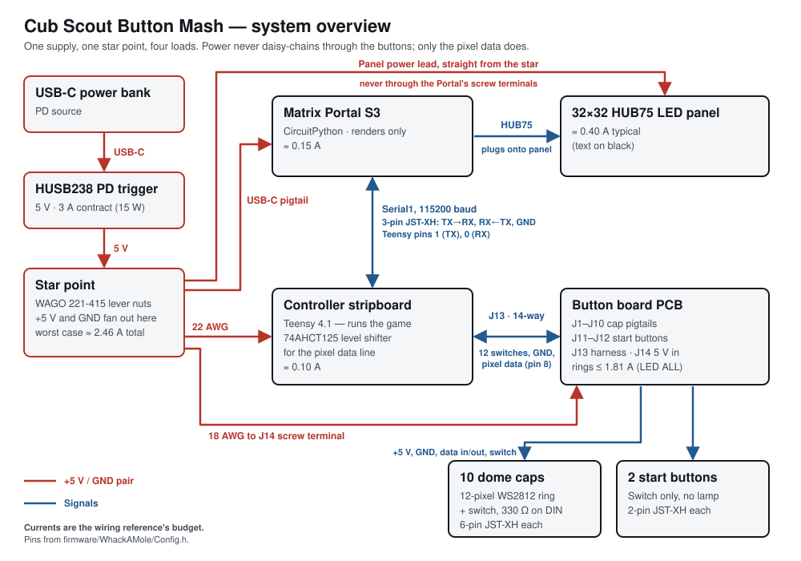
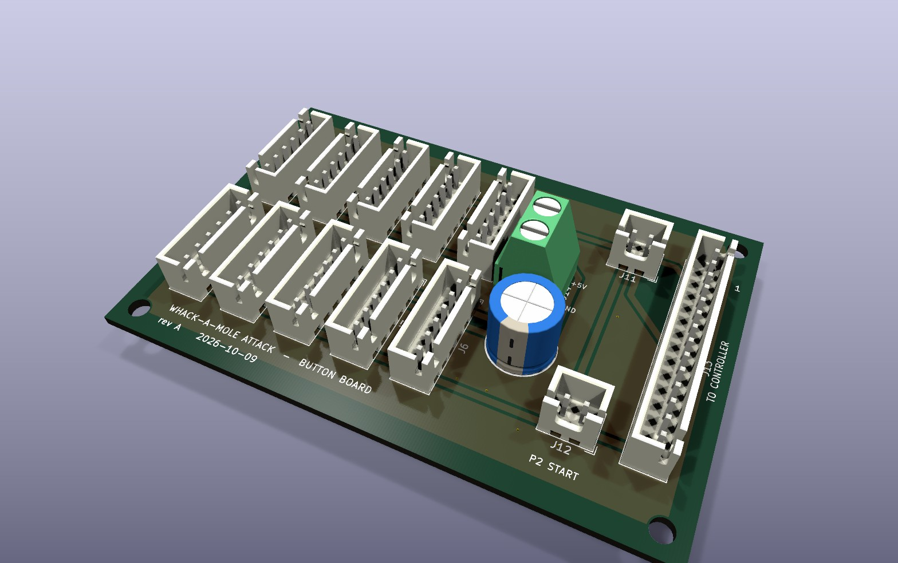
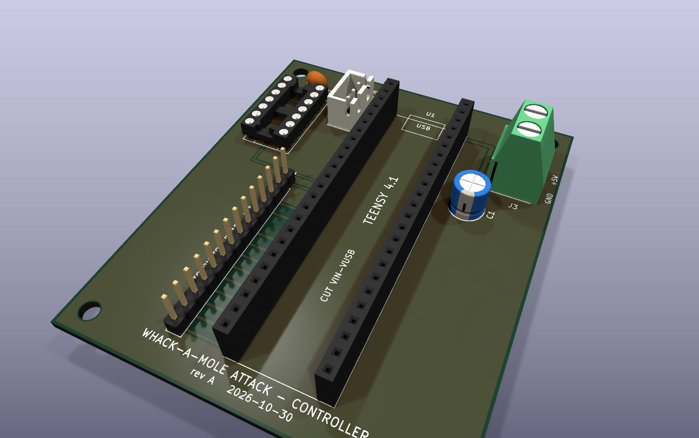

# whack-a-mole-attack

Project files for a two-player whack-a-mole / button mash game

Original idea by https://github.com/DIYTechBros/ButtonSmack / https://www.youtube.com/watch?v=FXypfZi_UDI

[](https://www.youtube.com/embed/DrATmFxHTjc)


Use a Teensy 4 to control the game, sending serial messages to a Matrix Portal for driving the graphics on a 32x32 LED Panel.

The table was built for a Cub Scout pack and plays as **Cub Scout Button Mash**: a medley of
five short games — whack-a-mole, colour finding, a chase around the ring, a colour puzzle,
and Simon — for one or two players. See [Game modes](#game-modes).

This is the second version of the table. The first ran on a resistor-ladder input, plain
dome lamps and a battery pack; its retrospective is at [the end](#version-1-retrospective).
The firmware still builds for both.

# Components

- [Teensy 4.1](https://www.pjrc.com/store/teensy41.html)
- [32x32 Adafruit LED Matrix](https://www.adafruit.com/product/2026)
- [Adafruit Matrix Portal S3](https://www.adafruit.com/product/5778)
- USB-C power bank + an HUSB238 PD trigger board configured for 5 V
  - Replaces the 2× 21700 pack and the XL4015 buck converter, both now removed from the
    design. The pack ran 8.4 V down to 6.0 V, below the XL4015's 8 V input floor for most
    of a discharge; once the current budget was corrected the table turned out to fit
    inside a 5 V / 3 A PD contract, so the converter went away rather than being worked
    around. [The wiring reference](docs/mole-table-wiring.pdf) records the decision, what
    it costs, and how to reverse it.
- 10 60mm dome push-buttons, each with a 12-pixel WS2812 ring in the cap
- 2 arcade buttons (player start)
- 74AHCT125 level shifter for the pixel data line

# Parts

- 73x100mm PCB strip board
- spade terminals + quick connectors
- wire
- connectors
- 330 Ω resistors (one per cap) and a 1000 µF capacitor
- JST-XH connectors and crimp contacts (parts lists in `docs/`)
- 10K resistors and an M/F barrel connector (version 1 only)
- 2x4s
- 1/2 inch finished plywood
- a few 3D printed pieces

# Layout

```
firmware/WhackAMole/   Teensy 4.1 sketch (Arduino/Teensyduino)
firmware/test/         Host-side tests: every game mode, no Teensy needed
display/               CircuitPython for the Matrix Portal S3, plus a host panel tester
docs/                  Wiring reference (HTML source + PDF), parts lists, doc tooling
hardware/              Button bushings (STL), the WS2812 ring carrier (OpenSCAD),
                       and both PCBs, button board and controller (KiCad, generated
                       from Python)
```

Copying `display/` onto the CIRCUITPY drive is most of it, but not all of it —
see [Flashing the Matrix Portal](#flashing-the-matrix-portal).

# Code

The Teensy owns the game. The Matrix Portal renders whatever it is told and holds no
game state of its own.

| File | Role |
| --- | --- |
| `firmware/WhackAMole/Config.h` | Every pin, timing value, and gameplay tunable. Nothing else holds a bare pin number. |
| `firmware/WhackAMole/Protocol.h` | The controller/display wire protocol. Mirrored by `HANDLERS` in `code.py`. |
| `firmware/WhackAMole/WhackAMole.ino` | Wires the hardware objects together and runs the loop. |
| `firmware/WhackAMole/Game.cpp` | Game states, transitions, and the messages sent for each. Runs the medley. |
| `firmware/WhackAMole/Mode.h` | `MODE_LIST`: every way to play, in order, with its banner and segment length. |
| `firmware/WhackAMole/Dance.cpp` | The splash screen's lamp dance: colours spinning round each ring, all caps flashing, alternate caps swapping. Timing in `Config.h`. |
| `firmware/WhackAMole/*Mode.cpp` | One file per mode: Whack, Captcha, Chase, Logic, Simon. See [Game modes](#game-modes). |
| `firmware/WhackAMole/Player.cpp` | One player's buttons, lamps and score. What a press *means* lives in the modes. |
| `firmware/WhackAMole/ButtonInput.cpp` | Buttons, with debounce and edge detection. Analog ladder or one GPIO per button. |
| `firmware/WhackAMole/Lights.cpp` | Button lamps. Plain on/off or WS2812 pixels. |
| `firmware/WhackAMole/Debug.cpp` | Hardware test screens. See below. |
| `display/code.py` | Listens on the UART and drives the panel. |
| `display/boot.py` | Decides whether the game or the host computer owns writes to CIRCUITPY. |
| `firmware/test/` | Host-side tests that play every mode. `make test`; no Teensy needed. |

Input and lamp hardware are selected at build time in `Config.h`:

```c
#define WAM_INPUT_GPIO    1   // 0 = analog resistor ladder, 1 = one GPIO per button
#define WAM_LIGHTS_PIXELS 1   // 0 = digital dome lamps,     1 = WS2812 in the caps
```

Both default to 1, the current table. For version 1's wiring, override them without
editing the file: `make upload GPIO=0 PIXELS=0`.
CI compiles all four combinations so neither path rots.

# Building

Needs `arduino-cli` with the Teensy core:

```sh
brew install arduino-cli
arduino-cli core install teensy:avr \
  --additional-urls https://www.pjrc.com/teensy/package_teensy_index.json
```

Then:

```sh
make build                    # compile the configuration selected in Config.h
make matrix                   # compile all four input/lamp combinations
make upload                   # compile and flash a connected Teensy
make lint                     # clang-format check + ruff + pin-table check
make test                     # play every game mode on this computer; no Teensy needed
```

# Flashing the Matrix Portal

The Portal runs CircuitPython, so this is three separate things: the interpreter,
one library, and the files in `display/`.

**Unplug the 5 V pigtail from the Portal's USB-C before connecting a computer.**
That port is both its power inlet and its data port, and its screw terminals are fed
from the same node. Adafruit warns that two sources on it at once can damage the board.

## 1. CircuitPython

Double-tap **RESET**; a bootloader drive appears. Drag the UF2 for this board onto it
from [circuitpython.org](https://circuitpython.org/board/adafruit_matrixportal_s3/).
It reboots as `CIRCUITPY`.

`code.py` uses `display.root_group`, so it needs **CircuitPython 9 or later**; 10.x is what it is developed against. Nothing in it
needs porting for 10.

## 2. The one library

`code.py` imports `adafruit_display_text`, which is neither built in nor in this repo.
Everything else it imports — `board`, `busio`, `displayio`, `framebufferio`,
`rgbmatrix`, `terminalio`, `storage`, `digitalio` — is already in the UF2.

```sh
uv tool install circup         # or: pipx install circup
circup install adafruit_display_text
```

A bare `pip install circup` fails on a Homebrew Python with
`externally-managed-environment`. Install it as a *tool*, not into this repo — a
virtualenv created inside `display/` drops a `.gitignore` containing `*`, which
silently hides every file in that directory from git, `code.py` included.

`circup` matches the bundle to the installed CircuitPython. By hand works too: copy
`adafruit_display_text/` out of the bundle for your major version into `CIRCUITPY/lib/`.
A bundle from the wrong major version fails at import with *incompatible .mpy file*.

## 3. The files

Both go in the **root** of `CIRCUITPY`.

```sh
cp display/code.py display/boot.py /Volumes/CIRCUITPY/
```

The splash is drawn in code, so there is no image to copy. A `running-monty-mole.bmp`
left on the drive from an older version is unused and can be deleted.

Copy `boot.py` last. On the next reset it calls `storage.remount("/", readonly=False)`,
which hands writes to the program and makes the drive **read-only to your computer**.
That is the point — it is what lets `highscore.txt` persist — but it does mean you
cannot drag files any more.

**To edit the drive again, hold the UP button while powering on.** If you are already
locked out, Ctrl-C into the REPL and run `import storage; storage.remount("/", readonly=True)`.

## Checking it

On reset, before any serial traffic, `code.py` shows the splash: **CUB SCOUT BUTTON
MASH**, one word at a time in two columns, green for P1 and pink for P2, over a spinning
rainbow pinwheel. That
proves CircuitPython, the library, the HUB75 wiring and the panel, with the Teensy not
involved. The splash gives way as soon as the Teensy sends anything, and
comes back each time the attract loop asks for it. The words, timings, pinwheel and the
small font the title is drawn in (needed because `BUTTON` is too long for the built-in
one) are at the top of `code.py`.

Meanwhile every cap lights white as soon as the Teensy boots, which draws enough to keep a
USB power bank from switching itself off. The caps go dark when the attract loop starts,
and then dance during its splash screen.

The handshake is Teensy-driven: it sends `#CONREADY` and waits in `DisplayReadyWait`,
and the Portal answers `#DSPREADY`. A panel that stays on the splash while the Teensy never advances
is a serial-link fault — check the TX/RX crossover first. Once they are talking, the
debug `DISPLAY` screen sends every protocol message in turn.

## When the panel itself is wrong

`display/panel-test.py` runs on the host, not the board, and drives the panel
directly over the CircuitPython REPL — one pattern at a time, naming each one and
then waiting for you, so what is on the panel and what is on screen cannot drift
apart. Each step states what you should see and what a deviation means.

```sh
python3 display/panel-test.py                # step through all fourteen
python3 display/panel-test.py --hold green   # hold one, hands free for probing
python3 display/panel-test.py --list         # names for --hold / --only
```

The order is deliberate: whether the panel blanks on command at all, then which
colour channels light at a current too low for the supply to matter, then the same
at full current, then geometry. A fault at a dim step is not a power problem; one
that appears only at full white is.

`--hold` is the one to reach for with a meter or a loose connector — it parks a
pattern indefinitely while you reseat the HUB75 socket or probe the panel's own
power terminals.

It interrupts `code.py` on the way in and soft-reboots on the way out, so the game
comes back by itself. Nothing is written to CIRCUITPY.

# Game modes

A game is a **medley**: every mode runs in turn, both players at once, each for its own
segment, with a banner between them. Score carries across all of them and the higher total
wins. The order and segment lengths are `MODE_LIST` in `Mode.h`; everything each mode does
inside its segment is tuned in `Config.h`.

| Mode | Banner | What you do |
| --- | --- | --- |
| Whack | `WHACK` | The original game. One cap blinks; hit it before it moves on. |
| Captcha | `FIND` | Your score turns a colour. Every cap shows a different colour, reshuffling; press the one that matches. |
| Chase | `CHASE` | Every cap dim white, one magenta runner circling. Hit the cap it's on — or the next one, just before it lands. Speeds up with each hit. |
| Logic | `LOGIC` | Each press steps a cap to its next colour. Get all five to the colour your score is showing. |
| Simon | `SIMON` | Watch the sequence, play it back. Right, and it grows by one; wrong or too slow, and it replays. |

Two things to check on the real table:

- **`kChasePath`** in `Config.h` is the order of the caps around each player's ring. It
  defaults to button-index order; set it to the real clockwise order or the runner will jump
  around rather than circle. The build refuses a list that skips or repeats a cap.
- **Point values are first guesses.** `make test` holds every mode with a wrong button to one
  rule — mashing at random loses points on average — but how the modes weigh against each
  other needs real players.

Adding a mode is a line in `MODE_LIST` and a class in `Mode.h`. Forgetting the class is a
compile error, and `make test` fails if its banner won't fit on the panel unscrolled.

# Debug mode

Hold **both start buttons together for two seconds** during the attract loop. Everything
reports to USB serial and mirrors a short banner onto the LED matrix, so the table can be
tested standing up with nothing plugged into it.

A lone start press waits `kStartArbitrationMs` (300 ms) before it starts a game, so the
second button has time to arrive. Without that the first press leaves attract mode
immediately and this gesture can never complete — which is exactly what happened once the
Matrix Portal began answering the handshake and the Teensy stopped sitting in
`DisplayReadyWait`, where nothing competes for the press.

- **P1 start** — next screen
- **P2 start** — act within the current screen
- **both held** — leave debug mode

| Screen | What it is for |
| --- | --- |
| LED WALK | Lights each cap in turn and names it. A cap that stays dark is a wiring fault. |
| LED ALL | Everything on solid. Sit here with a meter on the 5 V rail. |
| BUTTONS | The panel shows the held button, still: `P1 B1`–`P1 B5` in wiring order (blue, red, white, green, yellow), `P2 ST` for P2's start, `NONE` when nothing is down. Serial logs live raw values and colour names for both players. |
| CALIBRATE | Walks you through pressing every button, then prints a paste-ready `kLadderThresholds` table and a safe tolerance. Not needed once the buttons are on GPIOs. |
| DISPLAY | Sends every protocol message in turn so `code.py` can be checked against the full vocabulary without playing a round. |

# Circuit



- **[docs/mole-table-wiring.pdf](docs/mole-table-wiring.pdf)** — the full wiring
  reference: power topology and current budget, the controller stripboard, the button
  board, the per-cap connectors, and build order. `docs/wiring.html` is its source;
  `make wiring-pdf` rebuilds it.
- **[hardware/button-board/](hardware/button-board/)** — the button board as a KiCad PCB,
  with its schematic as a [PDF](hardware/button-board/button-board.pdf).



The button board, rendered from the KiCad layout (`make board-render`). Each cap plugs
into one of J1–J10 and each start button into J11 or J12. Power arrives at the J14 screw
terminal, and J13 carries every switch line and the pixel data back to the controller.

- **[hardware/controller-board/](hardware/controller-board/)** — the controller
  stripboard as a PCB: the socketed Teensy, the 74AHCT125, the harness header, the serial
  link to the Portal and the power terminal, with its schematic as a
  [PDF](hardware/controller-board/controller-board.pdf). Generated end to end from a
  netlist that reads `Config.h`; `make controller-board` rebuilds it and holds it to ERC,
  DRC and schematic parity. Not yet fabricated — the stripboard is what is in the table.



## Pin map

Authoritative version is `firmware/WhackAMole/Config.h`; `make check-pins` fails if the
wiring reference disagrees with it.

| Function | Pins |
| --- | --- |
| Display link (Serial1) | 0 (RX), 1 (TX) |
| Reserved for audio | 6, 7, 10, 18, 19, 20, 21, 23 |
| Floating pin, PRNG seed | 17 |
| **Current table** (`WAM_INPUT_GPIO=1`, `WAM_LIGHTS_PIXELS=1`) | |
| Buttons, one GPIO each (B R W G Y, start) | 9, 11, 12, 24, 25, 26 (P1) / 27, 28, 29, 30, 31, 32 (P2) |
| WS2812 data, both players on one chain | 8 |
| **Version 1** (`WAM_INPUT_GPIO=0`, `WAM_LIGHTS_PIXELS=0`) | |
| Analog ladder in | 27 (P1), 38 (P2) |
| Dome lamps | 28–32 (P1), 37–33 (P2) |

The display link was moved off `Serial2`. Pin 7 is `Serial2` RX **and** the I2S data pin
used by both candidate audio designs, so `Serial2` and sound cannot coexist.

# Version 1 retrospective

Written after the first table's first outing. Most of what it asks for is what version 2
became: a 6-pin JST-XH per cap, buttons on their own GPIOs, WS2812 rings in the caps, and
a USB-C power bank in place of the batteries and buck converter.

## What worked well

- The Teensy is an awesome little computer. Easy to code, super fast, really stable, and overall just worked all the time
- Using switches in series with 10K resistors in between is an awesome way to read in multiple distinct user inputs while only using one analog pin
- The serial communication between the teensy and the Portal Matrix worked better than I expected and was more than fast enough
- The physical dome buttons held up well to an hour of constant abuse from a whole pack of Cub Scouts
- The LED Matrix itself was nice and bright and refreshed quickly
- The 21700 batteries and buck converter worked great to power the whole thing (though
  the pack sat below the converter's rated input floor for most of its discharge — see
  the decision record in the wiring reference)

## What I would do different

- The LEDs on the dome buttons are not great, just not bright. The DIY TechBros design replaced the built-in resistor to improve brightness, but it didn't make much of an improvement for me.
- The wiring scheme I came up with worked but it was ugly. If I were going to rewire this, I'd use a 4-pin JST connector and ribbon cable per LED button. The inline resistors would need to be moved to the perf board.
- The analog ladder is clever but it cannot represent two buttons pressed at once — the
  intermediate voltage decodes as some third button. Since a rewire runs a fresh connector
  to every cap anyway, one more conductor per button buys real simultaneous-press handling
  and retires the threshold table entirely.

## Improvements

- SOUNDS! There is an audio break-out board for the Teensy, adding some sounds would really make the game have an arcade feel
- Better button LEDs. I may try to cram a few WS2812B LEDs into the Dome button housing

## Notes from the rewire

The wiring reference has the details; these are the decisions that shaped it.

- Drive WS2812s with **WS2812Serial**, not Adafruit NeoPixel or FastLED. The bit-banging
  drivers disable interrupts for the length of a frame, which jitters the display link and
  will audibly glitch audio.
- The Teensy 4.1 is 3.3 V logic and WS2812Bs want 0.7×VDD on data. Put a **74AHCT125**
  between the Teensy and the first pixel. This is the usual cause of flaky NeoPixel builds.
- A 330 Ω resistor in series with DIN inside **every** cap, so all ten buttons are
  interchangeable, and 1000 µF across the 5 V rail.
- 10 caps × 12-pixel rings = 120 pixels, **~7.2 A** at full white — far past what the
  supply can give. Only two caps are lit during play, but the debug ALL-ON screen is the
  true worst case, so `kPixelBrightness` is capped at 64/255 (~1.8 A). The two start
  buttons have no lamp and are not in the pixel chain.
- Per-cap connector, 6-pin JST-XH: +5 V, GND, DIN, DOUT, SW, SW-GND. Keep the switch return separate
  from the LED return — a ring at full white puts 720 mA down that ground, and sharing it
  offsets the input the Teensy is reading. The start buttons need two conductors only.
- Full topology, current budget and build order: [docs/mole-table-wiring.pdf](docs/mole-table-wiring.pdf).

## Button LED carrier

`hardware/button-led-carrier.scad` — two printed parts that put a 12-pixel WS2812 ring
behind the dome of the stock 60mm button. The ring seat friction-fits into the plunger
cavity; the bore plug replaces the LED holder in the switch bracket and routes the wires
down the hollow stem, so nothing flexes where the spring can reach it. Measurements and
assembly steps are in the file. The `assert`s at the top will refuse to render if your
ring is too tall for the 4mm cavity — measure `ring_height` before printing.

# Table design

From version 1; the playfield and frame carried over unchanged.

I started from the playfield (16x36 inches) and then just built a table from and legs underneath that. I needed to 3d print a few spacer/bushings so that the buttons were snug in the holes I cut (I didn't have a perfectly-sized hole saw). I also 3d printed 21700 battery holders. The battery holders and perf-board are just screwed to the underside with wood screws. The PortalMatrix is piggy-backed onto the back of the LED panel on the 2x10 socket connector. The LED panel is inset into the middle of the playfield; I added supports underneath to keep it flush with the playfield surface. I also added a 3d-printed bezel around the LED panel in an attempt to make it look like a mole hill and to discourage players from bonking it.
